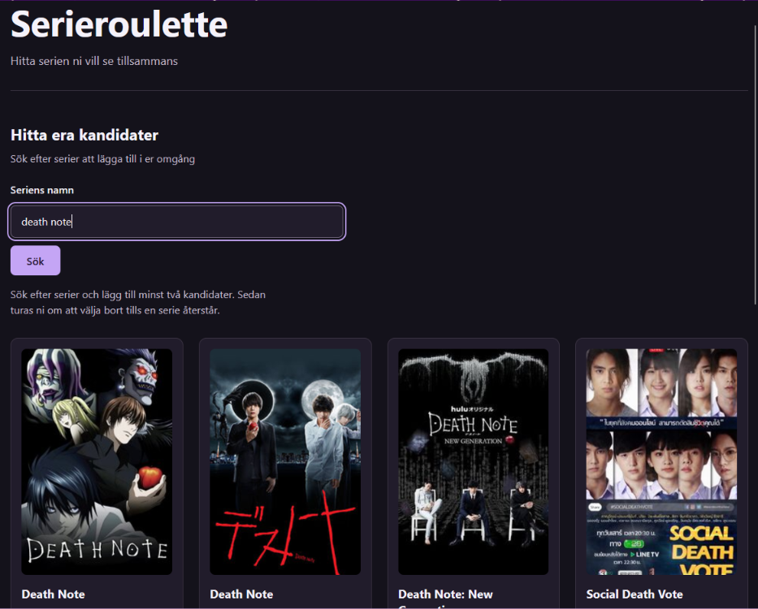
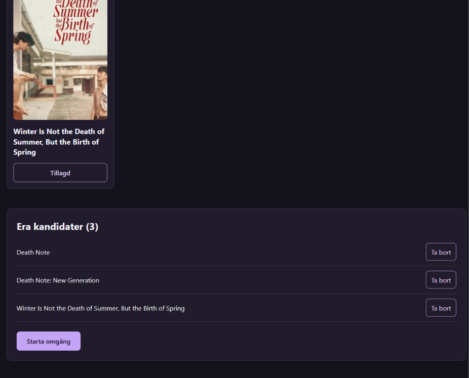
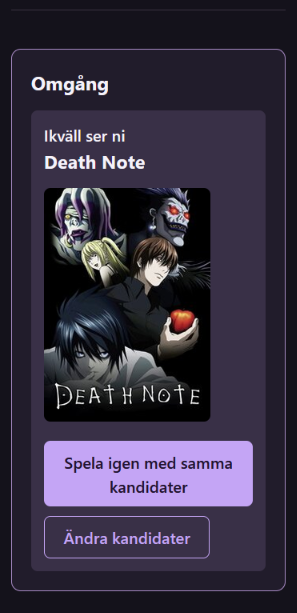

<div align="center">

# Serieroulette

### Mindre scrollande. Mer serietittande.

Hitta serien ni vill se tillsammans. Sök fram era favoriter och turas om att välja bort — tills kvällens serie återstår.


**Två spelare · En gemensam skärm · En serie kvar**



</div>

---

## 🎬 Om projektet

**Vad ska vi titta på ikväll?**

Serieroulette hjälper två personer att välja en serie tillsammans. I stället för att fortsätta leta bygger ni en gemensam lista och turas om att välja bort ett alternativ. När en serie återstår har ni kvällens vinnare.

Projektet började som en React- och TypeScriptövning inom kursen *Fullstack webbapplikation med TypeScript*. Det har därefter vidareutvecklats med ett tydligare spelflöde, återanvändbara komponenter och ett gränssnitt anpassat för både mobil och dator.

Applikationen är en frontend som hämtar seriedata från TVmaze. Den har ingen egen backend eller databas.

---

## ✨ Funktioner

### 🔎 Hitta era kandidater

- Sök efter serier via TVmaze och se resultat med titel och omslagsbild när sådan finns.
- Lägg till och ta bort kandidater utan dubbletter.
- Se direkt vilka sökträffar som redan är tillagda.
- Få vägledning tills minst två kandidater har valts.

### 🎲 Välj tillsammans

- Starta en omgång med minst två serier.
- Turas om på samma enhet — spelare 1 börjar varje omgång.
- Välj bort en serie per tur tills bara en återstår.
- Se en separat spelvy där sökning och kandidatlista är dolda under omgången.

### 🏆 Kvällens vinnare

- Se den vinnande seriens namn och omslagsbild när sådan finns.
- Spela igen med samma kandidater.
- Gå tillbaka och ändra kandidatlistan utan att förlora era val.

Trots namnet bygger valet på spelarnas bortval. Ingen serie slumpas fram.

---

## 📱 Design och användarupplevelse

Gränssnittet använder en mörk färgpalett med lila accenter och ett avgränsat flöde:

**Sök och välj → Spela omgången → Se vinnaren → Spela igen eller ändra kandidater**

På små skärmar placeras listornas knappar under serienamnen, så att även längre titlar får plats. Under spelet visas enbart omgången, och knapparna för nästa steg finns direkt i vinnarkortet.

Tillgänglighet har beaktats genom synliga formuläretiketter, semantiska sektioner, fokusmarkeringar för tangentbord och beskrivande knappetiketter. Status- och felmeddelanden använder `role="status"` respektive `role="alert"`.

Sökningen visar laddningsläge, tomma resultat, felmeddelanden och ett meddelande när en sökning väntar på nätverksanslutning.

---

## 🖼️ Skärmbilder

### Kandidatval på dator

Samla era alternativ i en gemensam lista. Tillagda serier markeras i sökresultaten, och ni kan ta bort kandidater innan omgången börjar.



### Vinnarläge på mobil

När en serie återstår samlas vinnaren och nästa steg i samma kort, så att ni kan spela igen eller ändra kandidater direkt.

<p align="center">
  
</p>

---

## 🛠️ Teknik och arkitektur

| Teknik | Användning |
| --- | --- |
| React | Komponenter, interaktion och lokalt state |
| TypeScript | Typer för seriedata, props, events och funktioner |
| TanStack Query | Hämtning, cache och status för sökningar |
| CSS | Responsiv layout, komponentnära styling och gemensamma färgvariabler |
| Vite | Lokal utvecklingsserver och produktionsbuild |
| ESLint | Statisk kodkontroll |
| TVmaze API | Sökresultat och seriebilder |

### Komponenter med tydliga ansvar

`App` kopplar ihop gränssnittets delar. Spellogiken finns i `useRoulette`, medan `ShowSearch` äger sökfältets state och använder `useShowSearch` för nätverksdata.

```text
src/
├── base/
│   └── Button/             # Gemensam knapp med typade HTML-props
├── components/
│   └── ShowCard/           # En sökträff med bild och kandidatknapp
├── shared/
│   ├── CandidateList/      # Kandidater, borttagning och start
│   ├── RouletteRound/      # Turordning, bortval, vinnare och omstart
│   └── ShowSearch/         # Sökformulär, sökstatus och resultatlista
├── core/
│   └── hooks/
│       ├── useRoulette.ts  # Kandidater och omgångens state
│       └── useShowSearch.ts
├── services/
│   └── searchShows.ts      # HTTP-anrop till TVmaze
├── types/
│   └── show.types.ts       # Datamodeller för serier och sökresultat
├── App.tsx                 # Sidans komposition
├── App.css                 # Sidans layout
├── index.css               # Reset, grundstil och färgvariabler
└── main.tsx                # Appstart och QueryClientProvider
```

Komponenterna får data och funktioner genom typade props. Det håller presentationen åtskild från spellogiken och gör delarna lättare att vidareutveckla.

---

## 🔗 Data och API

Sökningen använder TVmazes publika sökendpoint:

```http
GET https://api.tvmaze.com/search/shows?q=Friends
```

Ingen API-nyckel eller lokal miljöfil behövs. Söktexten kodas med `URLSearchParams`, och misslyckade HTTP-svar hanteras som fel.

Seriedata och omslagsbilder kommer från [TVmaze](https://www.tvmaze.com/). Se [API-dokumentationen och användningsvillkoren](https://www.tvmaze.com/api) för information om datakällan och dess licens.

---

## 🚀 Kör projektet lokalt

### Förutsättningar

- Node.js 22.12 eller senare i 22-serien, alternativt en senare version som stöds av Vite.
- npm.
- Internetanslutning för att hämta nya sökresultat och bilder.

### 1. Öppna projektmappen

Öppna en terminal i mappen `serieroulette`. Om du utgår från skolhubbens rot:

```powershell
cd projekt/aktiva/fullstack-typescript/ovningar/serieroulette
```

### 2. Installera beroenden

```powershell
npm install
```

### 3. Starta utvecklingsservern

```powershell
npm run dev
```

Öppna den lokala adress som Vite visar i terminalen.

### Kodkontroll och produktionsbuild

```powershell
npm run lint
npm run build
```

`build` kör TypeScript-kontrollen och skapar produktionsfiler i `dist/`. För att förhandsvisa den färdiga builden lokalt:

```powershell
npm run preview
```

---

## 🧪 Testa användarflödet

1. Sök efter en serie och lägg till den som kandidat. Knappen ska visa **Tillagd**.
2. Lägg till fler serier, ta bort en och kontrollera att den går att lägga till igen.
3. Starta med minst tre kandidater och kontrollera att sökning och kandidatlista döljs.
4. Välj bort serier och kontrollera att turen växlar mellan spelare 1 och 2.
5. Kontrollera att sista serien visas som vinnare och inte kan väljas bort.
6. Välj **Spela igen med samma kandidater** och kontrollera att alla kandidater återkommer.
7. Spela klart och välj **Ändra kandidater**. Kandidatlistan ska finnas kvar.

Prova även mobilbredd, tangentbordsnavigering, en sökning utan träffar och ett nätverksfel. Projektet har för närvarande ingen automatiserad testsvit; `lint` och `build` kompletterar de manuella flödestesterna.

---

## 📌 Omfattning

- Två personer spelar lokalt på samma enhet. Ingen synkronisering mellan enheter ingår.
- Kandidater och omgång sparas i React-state och återställs när sidan laddas om.
- När ni återgår till kandidatvalet återställs sökfältet, medan kandidaterna behålls.
- TanStack Query kan återanvända cachade sökresultat, men appen är ingen fullständig offlinelösning.
- Appen visar seriedata och hjälper er att välja; den spelar inte upp serier och visar inte var de kan streamas.

---

## 🌱 Lärdomar och vidareutveckling

Projektet tränar typade API-anrop, nullable bilddata, props, React-events och state. Vidareutvecklingen har också fokuserat på att dela upp ansvar mellan komponenter och hooks samt att förbättra återkoppling och layout för små skärmar.

Möjliga framtida förbättringar är sparade kandidater mellan besök, egna spelarnamn och automatiserade tester av spellogiken. Dessa funktioner ingår inte i den nuvarande versionen.

Det finns också en tanke om att publicera applikationen när tid finns, så att den enkelt kan öppnas i webbläsaren utan lokal installation. Målet är att kunna använda Serieroulette tillsammans med sin partner en vanlig kväll när det är svårt att komma överens om vad man ska titta på. Publicering är planerad och ännu inte genomförd.

---

<div align="center">

**Utvecklat av Sara Berg**

*En React- och TypeScriptövning med fokus på gemensamma val och tydlig interaktion.*

</div>


